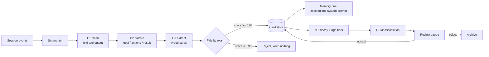

# rem · 梦忆

**Sleep-stage memory for AI coding agents.**

[](LICENSE)
[](https://nodejs.org)
[](https://github.com/deepseek-ai/DeepSeek-Harness)
[](#status)

---

Your coding agent has amnesia.

Every session starts from zero. Context compaction buys a few more turns, then throws away *why* a decision was made. RAG-style memory stores fragments and lets the original transcript rot.

`rem` gives the agent a **sleep cycle** instead:

> compress the raw transcript → replay it offline → consolidate what matters → forget the rest → review the dreams.

It is built as a plugin for **DeepSeek Harness (DSH)**, with a sidebar panel, native tools, and a `/rem-sleep` command.

---

## The 30-second pitch

| Typical memory layer | rem |
|---|---|
| Chunks transcripts into embeddings | **Compresses the transcript itself** (C0 → C4) |
| One "summarize" call | **Four sleep stages** (N1 index → N2 replay → N3 consolidate → REM associate) |
| Trusts the summary | **Fidelity exam**: closed-book questions; below 0.95 nothing is stored |
| Memory is opaque | Every card points back to `session + seq`, and `memory_expand` reopens the compressed source |
| Grows forever | Weight decay, 7/30-day age tiers, per-scope index cards |

---

## Demo

A real dream report from the plugin:

```text
## 梦境报告

模式：手动 · 耗时 115s
处理：3 段 · 落卡 15 张 · 拒绝 0 段 · 跳过 0 段
N3：衰减 84 张 · 归档 3 张 · REM 假设 0 条
分层：清理原文 0 段 · 超龄归档 0 张
平均保真度：1.00

### 明细
- seg_..._54：落卡 5 张
- seg_..._53：落卡 5 张
- seg_..._52：落卡 5 张
```

A card can always be expanded back to the compressed source:

```text
## 原文展开

片段：seg_...
会话：session-... · seq 2841-2900
长度：4,120 字符

T(read) {"path":"src/index.ts"}
R(read): import { defineTool } ...
...
```

And when the model dreams up a connection, it stays quarantined until you accept it:

```text
## 待评审（REM 假设）

1. 下次插件 apply 初始化访问未声明的 storageDomain 时，用 try/catch 包裹后
   验证宿主启动是否从崩溃降级为日志错误。
   confidence 0.55 · id mem_...
```

---

## How it works



### Compression ladder

| Level | What it is | Approx. ratio | Reversible |
|---|---|---|---|
| **C0** | raw session events | 1× | — |
| **C1** | cleaned (tool output folded, diffs collapsed, retries merged, secrets redacted) | 2–3× | yes |
| **C2** | structured narrative: goal / actions / result / decisions / failures | ~18× | via C1 |
| **C3** | typed cards: `decision`, `preference`, `fact`, `procedure`, `failure`, `entity`, `hypothesis` | ~150× | via source anchors |
| **C4** | one-line index in the injected brief | ~1000× | via card id |

A card is never the only copy: `sources: [{ sessionId, seqStart, seqEnd }]` plus a
`segments` table holding the C1 text make `memory_expand` possible.

### Sleep stages

| Stage | What happens | Cost |
|---|---|---|
| **N1** | segment and index new turns | rules only |
| **N2** | replay high-salience segments, draft cards | C2 + C3 calls |
| **N3** | consolidate, merge duplicates, decay weights, apply 7/30-day tiers | rules + storage |
| **REM** | associate distant cards into testable hypotheses | one call, manual sleep only |
| **Wake** | rewrite brief, dream report | rules |

Weight decay is a simple `weight *= 0.95` per sleep; cards below `0.2` are archived.
Cards older than 30 days **and** lighter than `0.3` are archived by the age tier.
Every sleep is budgeted: 2 segments automatically, up to 3 manually.

---

## Quick start

Requirements: **DSH ≥ 0.2.0-rc.1** and **Node ≥ 22**.

```bash
git clone https://github.com/senlinzhixing/rem-memory.git
cd rem-memory
pnpm install
pnpm build

# install into a DSH profile
dsh plugin --profile rem add .
dsh --profile rem
```

Open any session, expand the right sidebar, click `+`, and pick **rem**.
The table is served by the plugin; the panel reads a snapshot written into
`<workspace>/.rem/status.json`.

> The profile name is up to you. Restart DSH after installing or upgrading —
> the host loads plugin bundles at startup.

### First run

1. Chat normally for a few turns.
2. Click **立即整理** (or type `/rem-sleep`): the host runs a sleep cycle.
3. Open the panel: pressure drops, cards appear, a dream report is written.
4. Ask the agent to `memory_recall` something, or call `memory_expand` on a card.

---

## Tools

| Tool | Purpose |
|---|---|
| `memory_status` | pressure, card counts, storage mode, last dream |
| `memory_episodes` | list segments produced by the segmenter |
| `memory_compress` | run C1 rules and show compression stats |
| `memory_narrate` | run C2 narrative on one segment |
| `memory_extract` | C2 → C3 → fidelity → store |
| `memory_cards` | list active cards, newest first |
| `memory_read` | print one card with sources |
| `memory_expand` | reopen the C1 source behind a card |
| `memory_recall` | keyword search over active cards |
| `memory_sleep` | run a sleep cycle |
| `memory_review` | list / accept / reject REM hypotheses |

Slash command: **`/rem-sleep`** — runs a sleep cycle **without a model turn**.

---

## Privacy

- Everything lives on your machine: cards in `~/.dsh/storages/rem/`, a small
  snapshot in `<workspace>/.rem/status.json`.
- The only network calls are to the model provider you already configured in DSH.
- No telemetry, no accounts, no cloud.
- Tool output is redacted for common key patterns before it is stored.

`.rem/` is safe to gitignore; if you want a shared memory, commit the storage
directory instead (it is plain JSON, one record per file).

---

## Why "sleep"?

Sleep is not a metaphor here — it is an algorithm.

- **Replay** ( hippocampal replay ): re-read salient segments before compressing.
- **Systems consolidation**: turn episodic detail into semantic cards.
- **Synaptic downscaling**: decay everything a little, archive what is never used.
- **REM recombination**: connect distant memories, but quarantine the result.

The design follows the memory hierarchy described in Anthropic's
[*The components of agent memory*](https://www.anthropic.com/research/components-of-agent-memory)
and Letta/Berkeley's
[*Sleep-time Compute*](https://arxiv.org/abs/2504.13171).

---

## Status

Alpha, but the loop is real:

- [x] DSH bundle + sidebar panel
- [x] segmentation, C1, C2, C3
- [x] fidelity gate (default 6 questions, threshold 0.95)
- [x] persistent storage, recall, `memory_expand`
- [x] N3 decay + 7/30-day age tiers + scope index cards
- [x] REM hypotheses + review queue
- [x] `/rem-sleep` command without model turn
- [ ] conflict detection between cards
- [ ] cross-harness adapters (Claude Code, Codex)
- [ ] team sync / git-backed shared memory

See [docs/architecture.md](docs/architecture.md) for the long version.

---

## Comparison

| | compresses source | offline consolidation | provenance | human review | storage |
|---|---|---|---|---|---|
| Mem0 / Zep | ✗ (extracts) | partial | partial | ✗ | vector / graph DB |
| Basic Memory | ✗ | ✗ | ✓ | ✗ | Markdown |
| claude-mem | ✗ | session-end only | ✓ | ✗ | SQLite |
| **rem** | **✓ C0→C4** | **✓ four stages** | **✓ seq anchors** | **✓** | **JSON / SQLite via DSH** |

---

## FAQ

**Does it work with Claude Code / Codex?**
Not yet. DSH first — the plugin depends on DSH's session events and slot system.
The compression and sleep engine are harness-agnostic; adapters are on the roadmap.

**Does it call the model on every message?**
No. Segmentation and C1 are pure rules. Model calls happen only during
`memory_extract` / sleep, and `/rem-sleep` itself does not consume a model turn.

**How much does a sleep cost?**
Roughly 10 calls per segment (narrative + extraction + fidelity questions).
The default budget is 2 segments per automatic sleep, 3 per manual one.

**Where is the data?**
`~/.dsh/storages/rem/` — one JSON file per card/segment/report. You can read,
diff, back up, and delete it without the plugin.

---

## Contributing

Issues and PRs are welcome. Start with [CONTRIBUTING.md](CONTRIBUTING.md);
`pnpm verify` runs offline and needs no host.

If this idea resonates — agents that sleep on their work instead of forgetting
it — **star the repo**. It helps more people find it.

## License

MIT
