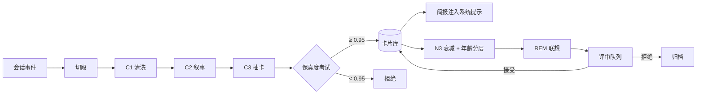

# rem · 梦忆

**给 AI 编程智能体的"睡眠式"记忆层。**

[](LICENSE)
[](https://nodejs.org)

---

你的编程智能体有失忆症。

每次会话都从零开始。上下文压缩多撑几轮之后，就把"为什么这样决定"丢掉了。RAG 式记忆存下碎片，然后让原始记录烂在日志里。

`rem` 给它一个**睡眠周期**：

> 压缩原文 → 离线重放 → 巩固要点 → 遗忘细节 → 醒来评审。

它是 **DeepSeek Harness（DSH）** 的插件，带侧栏面板、原生工具和 `/rem-sleep` 命令。

---

## 和常见记忆层的区别

| 常见做法 | rem |
|---|---|
| 把对话切成块做向量 | **压缩对话原文本身**（C0 → C4） |
| 调一次"总结" | **四个睡眠阶段**（N1 索引 → N2 重放 → N3 巩固 → REM 联想） |
| 信任摘要 | **保真度考试**：闭卷提问，低于 0.95 一律不落卡 |
| 记忆不可追溯 | 每张卡带 `session + seq` 锚点，`memory_expand` 可展开原文 |
| 无限增长 | 权重衰减、7/30 天分层、按 scope 生成索引卡 |

## 实际效果

```
## 梦境报告
模式：手动 · 耗时 115s
处理：3 段 · 落卡 15 张 · 拒绝 0 段
N3：衰减 84 张 · 归档 3 张
分层：清理原文 0 段 · 超龄归档 0 张
平均保真度：1.00
```

卡片可以随时展开回压缩后的原文：

```
## 原文展开
片段：seg_...
会话：session-... · seq 2841-2900
长度：4,120 字符

T(read) {"path":"src/index.ts"}
R(read): import { defineTool } ...
```

REM 期产生的联想默认隔离，必须人工接受才会进入活跃记忆。

## 工作方式



### 压缩阶梯

| 层级 | 内容 | 压缩比 | 可回溯 |
|---|---|---|---|
| C0 | 原始事件 | 1× | — |
| C1 | 清洗（工具输出折叠、diff 压缩、重试合并、脱敏） | 2–3× | 是 |
| C2 | 结构化叙事（目标/动作/结果/决定/失败） | ~18× | 经 C1 |
| C3 | 类型化卡片 | ~150× | 经来源锚点 |
| C4 | 注入用的一行索引 | ~1000× | 经卡片 id |

### 四个阶段

| 阶段 | 做什么 | 成本 |
|---|---|---|
| N1 | 切段、建索引 | 纯规则 |
| N2 | 重放高 salience 片段、起草卡片 | C2 + C3 |
| N3 | 合并、衰减、7/30 天分层 | 规则 + 存储 |
| REM | 远距离卡片配对，生成可验证假设 | 一次调用（仅手动睡眠） |
| 醒来 | 重写简报、生成梦境报告 | 纯规则 |

## 快速开始

要求：**DSH ≥ 0.2.0-rc.1**、**Node ≥ 22**。

```bash
git clone https://github.com/senlinzhixing/rem-memory.git
cd rem-memory
pnpm install
pnpm build

dsh plugin --profile rem add .
dsh --profile rem
```

打开任意会话 → 右侧栏 → `+` → **rem**。

第一次使用：

1. 正常聊几轮
2. 点面板的「立即整理」，或输入 `/rem-sleep`
3. 面板出现卡片与梦境报告
4. 用 `memory_recall` 检索，或 `memory_expand` 展开原文

## 隐私

- 所有数据都在本机：卡片在 `~/.dsh/storages/rem/`，快照在工作区 `.rem/status.json`
- 唯一的网络请求发给你在 DSH 里配置好的模型
- 没有遥测、账号、云服务
- 常见密钥格式在入库前会被脱敏

## 为什么是"睡眠"？

这不是比喻，是算法：

- **重放**：压缩前先重读高权重片段
- **系统巩固**：把情节记忆变成语义卡片
- **突触下调**：整体衰减，长期不用的归档
- **REM 重组**：连接远距离记忆，但结果先隔离

设计参考了 Letta/Berkeley 的
[《Sleep-time Compute》](https://arxiv.org/abs/2504.13171)。

## 状态

Alpha，但闭环是真实的：

- [x] DSH 组合包 + 侧栏面板
- [x] 切段 / C1 / C2 / C3
- [x] 保真度门禁（默认 6 题，阈值 0.95）
- [x] 持久化、检索、`memory_expand`
- [x] N3 衰减 + 年龄分层 + scope 索引卡
- [x] REM 假设 + 评审队列
- [x] `/rem-sleep`（不消耗模型轮次）
- [ ] 卡片冲突检测
- [ ] 跨 harness 适配（Claude Code、Codex）
- [ ] 团队同步

详细设计见 [docs/architecture.md](docs/architecture.md)。

## 贡献

欢迎 Issue 和 PR。先看 [CONTRIBUTING.md](CONTRIBUTING.md)，`pnpm verify` 完全离线，不需要宿主。

如果这个想法对你有启发——让智能体**睡一觉再记住**，而不是聊完就忘——**给个 Star**。

## License

MIT
